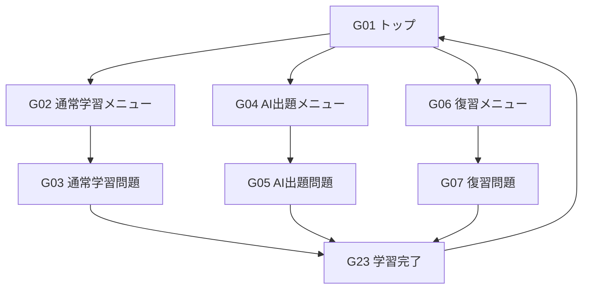
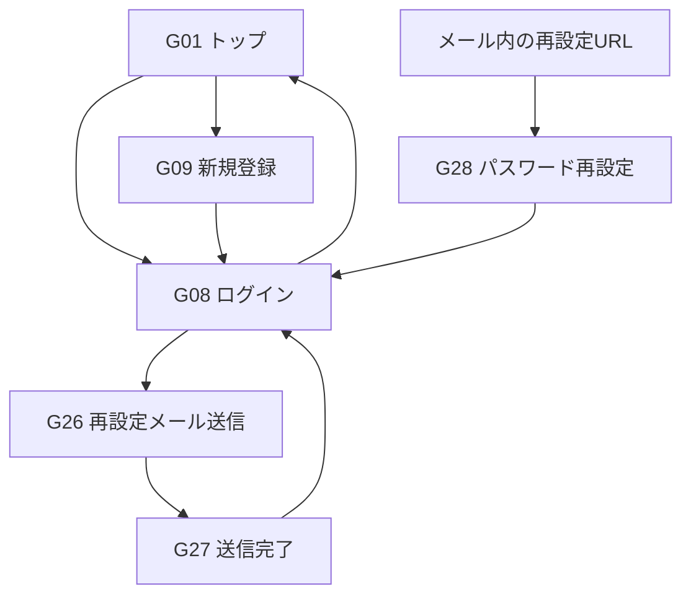
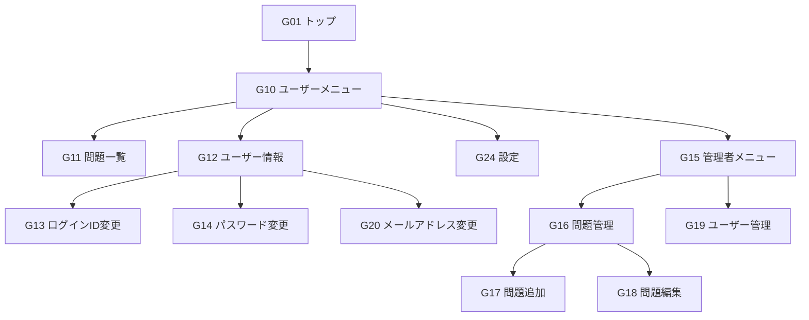
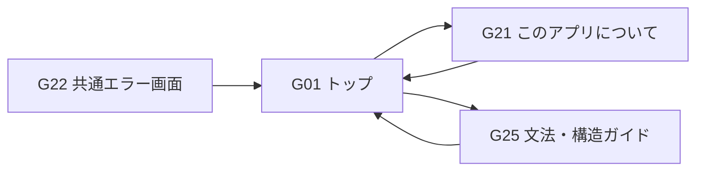

# 画面遷移図

Chinese Output Forgeの主要な画面遷移を機能別に示す。各画面の入力項目・バリデーション・詳細な操作仕様は[`screen-design-details.md`](screen-design-details.md)を参照。

## 1. 学習機能

通常学習は未ログインでも利用できる。AI生成学習と復習はログインが必要で、未ログイン時はG08へ遷移する。各問題画面では次の問題へ進めるほか、中断時は対応する学習メニューに戻る。学習完了後は同じ学習モードを継続できる。

## 2. 認証・アカウント

ログイン成功後は、必要に応じてログイン前に選択したAI生成学習・復習画面へ進む。G28はメールに記載されたURLからアクセスする。

## 3. ユーザー機能・管理者機能

G10以降のユーザー機能はログインが必要。G15〜G19は管理者権限が必要で、画面リンクだけでなくサーバー側でもアクセスを制限する。各変更画面の完了後は原則として元の一覧・情報画面へ戻る。

## 4. その他の画面

G22は各画面で発生したエラーを共通して扱うため、個々の画面からの矢印は省略する。

## 5. 共通ルール

- 学習対象言語（`MAINLAND` / `TAIWAN`）に応じて問題を切り替えるが、画面自体は共通とする。
- 発音表記（`PINYIN` / `ZHUYIN` / `NONE`）とサイト表記言語は、学習対象言語とは独立している。
- ログインユーザーの学習対象言語・発音表記は`users`テーブルに保存する。
- 学習中は開始時の学習対象言語を維持する。

> 本資料は主要な遷移を示す概要図。各画面の戻る操作、同一画面での更新、例外時の遷移などは必要に応じて詳細設計・実装を参照する。
